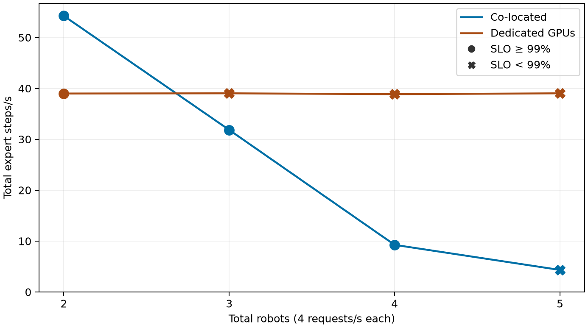

# 225 W A6000 两卡布局

单卡 1–3 台五分钟扫描中达标的最大值为 2 台。十分钟测量中，共跑为4 台，分卡为2 台。

| 布局 | 总台数（卡 0+1） | 合并专家数（卡 0/1） | P99 ms | SLO | 合计专家步/s | 达标 | 外部 GPU 2/3 平均占用 |
|---|---:|---:|---:|---:|---:|---|---:|
| 单卡推理 | 1（1+0） | — / — | 119.4 | 100.00% | 0.000 | 是 | 79% / 99% |
| 单卡推理 | 2（2+0） | — / — | 120.4 | 100.00% | 0.000 | 是 | 99% / 85% |
| 单卡推理 | 3（3+0） | — / — | 618.7 | 0.28% | 0.000 | 否 | 98% / 100% |
| 两卡共跑 | 2（1+1） | 8 / 8 | 156.5 | 100.00% | 54.240 | 是 | 90% / 100% |
| 分卡 | 2（2+0） | — / 8 | 121.0 | 100.00% | 38.987 | 是 | 93% / 99% |
| 两卡共跑 | 3（2+1） | 1 / 8 | 246.4 | 99.31% | 31.833 | 是 | 99% / 92% |
| 分卡 | 3（3+0） | — / 8 | 619.8 | 0.15% | 39.027 | 否 | 100% / 90% |
| 两卡共跑 | 4（2+2） | 1 / 1 | 249.9 | 99.00% | 9.257 | 是 | 99% / 100% |
| 分卡 | 4（4+0） | — / 8 | 105152.9 | 0.03% | 38.853 | 否 | 92% / 92% |
| 两卡共跑 | 5（3+2） | 1 / 1 | 1177.4 | 39.61% | 4.328 | 否 | 99% / 91% |
| 分卡 | 5（5+0） | — / 8 | 279424.5 | 0.03% | 39.027 | 否 | 99% / 98% |

被测代码为 654017a。两组从相同的全局错峰请求序列取数，每台机器人 4 Hz，时限 250 ms。共跑按机器人编号奇偶路由，奇数台时 GPU 0 多服务一台。两卡共用一个起始时间。P99 和 SLO 按全部计划到达的请求合并计算，包括窗口结束后才返回的请求；训练吞吐只计正式窗口中完成的专家更新。

静态推理为 CUDA Graph 前缀和手工去噪。每个完整的 104 请求回合抽取 8 次异步导出。训练沿用套件的固定服务缓存样本库、GPU 组 batch、图内前反向和图外优化器。共跑采用两套独立无配额 MPS，r32 前馈按卡上实测到达率乘以单请求服务时间选取专家数，沿用 70%/80%/85% 对应 8/2/1 个专家的配置，档间取相邻较小值。每 5 秒根据超时率调整占空比，发起训练前检查 200 ms 余量保护。分卡训练持续合并 8 个专家。每个布局角色固定独立的 8 个 CPU 核。表中专家数为控制器实际设置，CSV 另列每张卡按合并宽度统计的已完成更新数和专家步/s。

GPU 2/3 的外部占用每 5 秒采样。CSV 附各组的采样数与峰值显存。单卡容量组的墙钟开始时间由结果写入时刻和排空耗时反推，布局组直接记录共同起点。原始结果保存在测量机 /var/tmp/evo-layout-654017a/raw。

3 台共跑时，全部请求的 SLO 为 99.31%，GPU 0 和 GPU 1 各为 98.96%、100.00%。容量按全体请求判定。

4 台共跑时，全部请求的 SLO 为 99.00%，GPU 0 和 GPU 1 各为 99.04%、98.96%。容量按全体请求判定。

若要求两张共跑卡分别达到 99%，本轮最大值为 2 台。
