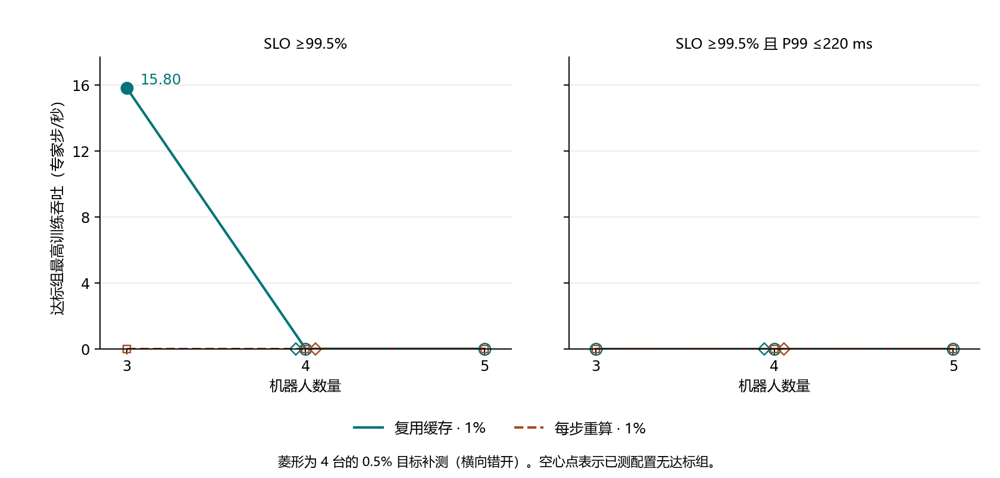

# H100 单卡机器人补测 · 2026-11-23

标准套件成功完成 27/28 项，4 台的 0.5% 超时目标补测完成 3/3 项，独立压力测试和诊断完成 3/3 项。标准组顺序为 5、6、4、3 台，每台每秒错峰发送 4 个请求，每组正式测量 300 秒。SLO 是在 250 ms 内返回的请求比例。

测量版本为 h100-suite 的 c5c653b8ea51491947c8158445543d622b1f7543。H100 80GB HBM3，驱动 595.112.07，功耗上限 700 W。Pod 可见 192 个逻辑 CPU，cgroup 配额相当于 20.4 核。CPU 栏按 8 个逻辑核折算，为正式窗口内的 Pod 平均值及 1 秒峰值。

## 按需导出对延迟的影响

每台机器人在 104 个请求的完整回合内随机选 8 个。表中导出量是实际选中请求的 KV 字节数。目标为相对同台数纯推理的 P99 增量不超过 10 ms，且导出组 SLO 至少 99.5%。

| 台数 | 导出规则 | 纯推理 P99 ms | 导出 P99 ms | 增量 ms | 纯推理 SLO | 导出 SLO | 导出请求 / 总请求 | 导出 GiB | CPU 平均 / 峰值 | 达标 |
|---:|---|---:|---:|---:|---:|---:|---:|---:|---:|---|
| 5 | 纯推理 + 按需导出 | 191.40 | 175.31 | -16.09 | 99.983% | 99.967% | 459 / 6000 | 7.63 | 12.90% / 14.49% | 是 |
| 6 | 纯推理 + 按需导出 | 256.68 | 256.23 | -0.45 | 93.917% | 94.639% | 554 / 7200 | 9.21 | 12.92% / 16.10% | 否 |
| 4 | 纯推理 + 按需导出 | 177.75 | 175.68 | -2.07 | 100.000% | 99.979% | 368 / 4800 | 6.12 | 12.93% / 14.85% | 是 |
| 3 | 纯推理 + 按需导出 | 110.40 | 108.19 | -2.21 | 100.000% | 100.000% | 274 / 3600 | 4.55 | 12.26% / 14.54% | 是 |

## 前馈表与达标吞吐

前馈宽度取有训练进展且同时满足 SLO ≥99.5%、P99 ≤220 ms 的最大缓存专家数。吞吐按完成的专家步折算。另列仅满足 SLO ≥99.5% 时的最高吞吐，以便识别 P99 门槛的影响。套件原样输出的 feedforward.json 中，cache 和 recompute 两个吞吐字段使用较宽的 SLO ≥99% 门槛，safe_experts 使用双门槛。

| 台数 | 前馈最大专家数 | 该宽度专家步/秒 | 双门槛最高吞吐 缓存 / 重算 | 仅 SLO ≥99.5% 最高吞吐 缓存 / 重算 |
|---:|---:|---:|---|---|
| 3 | 0 | — | 无达标组 / 无达标组 | 15.800（2 专家） / 无达标组 |
| 4 | 0 | — | 无达标组 / 无达标组 | 无达标组 / 无达标组 |
| 5 | 0 | — | 无达标组 / 无达标组 | 无达标组 / 无达标组 |
| 6 | 0 | — | 无达标组 / 无达标组 | 无达标组 / 无达标组 |

6 台的 4 专家组缺少正式样本。该行前馈宽度和最高吞吐只覆盖已完成的配置，缺测档位的表现未知。

## 4 台的两种超时率反馈目标

标准组目标为 1%；三个补测组仅将反馈项中的目标改为 0.5%。反馈增益为 5，反馈周期为 5 秒，推理攒批窗口为 10 ms，队列保护阈值为 200 ms。两轮使用相同的 4 台服务时间标定。

| 目标超时率 | 模式 | 专家 | P99 ms | SLO | 专家步/秒 | 平均占空比 | SLO ≥99.5% | 同时 P99 ≤220 ms |
|---:|---|---:|---:|---:|---:|---:|---|---|
| 1% | 复用缓存 | 1 | 250.07 | 98.979% | 5.887 | 69.53% | 否 | 否 |
| 1% | 复用缓存 | 2 | 250.70 | 98.875% | 8.860 | 65.39% | 否 | 否 |
| 1% | 复用缓存 | 4 | 253.88 | 98.667% | 12.973 | 60.78% | 否 | 否 |
| 1% | 复用缓存 | 8 | 253.91 | 98.667% | 18.560 | 61.43% | 否 | 否 |
| 1% | 每步重算 VLM | 1 | 287.34 | 97.833% | 0.177 | 6.73% | 否 | 否 |
| 0.5% | 复用缓存 | 8 | 251.64 | 98.917% | 10.240 | 33.53% | 否 | 否 |
| 0.5% | 复用缓存 | 1 | 240.34 | 99.458% | 5.340 | 66.50% | 否 | 否 |
| 0.5% | 每步重算 VLM | 1 | 285.23 | 98.250% | 0.140 | 3.91% | 否 | 否 |

0.5% 目标下，在已测的 1、8 专家缓存组中，满足双门槛的最大宽度为 0。该目标下没有测缓存 2、4 专家。原始 1% 目标结果与各目标的最佳吞吐分别记录在 feedforward.json 的 4.controller_targets 中。

## 标准套件全部组

复用缓存与每步重算均使用 r32、GPU 组 batch 和前反向 CUDA Graph，优化器在图外。两组均启用超时反馈和 200 ms 队列时间余量保护。占空比为控制器命令的时间加权均值。缓存共跑在推理端按需导出，训练端使用套件预装的基准样本。

| 台数 | 模式 | 专家数 | P99 ms | SLO | 专家步/秒 | 平均占空比 | 导出数 | 导出 GiB | CPU 平均 / 峰值 | 并发方式 |
|---:|---|---:|---:|---:|---:|---:|---:|---:|---:|---|
| 5 | 纯推理 | — | 191.40 | 99.983% | — | — | 0 | 0.00 | 12.88% / 14.29% | inference |
| 5 | 纯推理 + 按需导出 | — | 175.31 | 99.967% | — | — | 459 | 7.63 | 12.90% / 14.49% | inference |
| 5 | 复用缓存 | 1 | 267.01 | 94.767% | 0.113 | 1.76% | 459 | 7.63 | 13.41% / 24.49% | mps |
| 5 | 复用缓存 | 2 | 263.22 | 94.950% | 0.233 | 1.85% | 459 | 7.63 | 13.68% / 29.46% | mps |
| 5 | 复用缓存 | 4 | 266.37 | 95.817% | 0.427 | 1.78% | 459 | 7.63 | 13.44% / 29.41% | mps |
| 5 | 复用缓存 | 8 | 272.38 | 94.650% | 0.613 | 1.79% | 459 | 7.63 | 13.50% / 28.44% | mps |
| 5 | 每步重算 VLM | 1 | 406.48 | 97.133% | 0.157 | 4.19% | 0 | 0.00 | 13.72% / 25.16% | streams |
| 6 | 纯推理 | — | 256.68 | 93.917% | — | — | 0 | 0.00 | 12.91% / 14.60% | inference |
| 6 | 纯推理 + 按需导出 | — | 256.23 | 94.639% | — | — | 554 | 9.21 | 12.92% / 16.10% | inference |
| 6 | 复用缓存 | 1 | 325.14 | 76.222% | 0.137 | 1.80% | 554 | 9.21 | 13.35% / 25.27% | mps |
| 6 | 复用缓存 | 2 | 402.29 | 70.861% | 0.227 | 1.80% | 554 | 9.21 | 13.45% / 29.54% | mps |
| 6 | 复用缓存 | 8 | 349.79 | 75.014% | 0.587 | 1.76% | 554 | 9.21 | 13.45% / 28.49% | mps |
| 6 | 每步重算 VLM | 1 | 396.00 | 91.097% | 0.057 | 1.89% | 0 | 0.00 | 13.42% / 25.27% | streams |
| 4 | 纯推理 | — | 177.75 | 100.000% | — | — | 0 | 0.00 | 12.94% / 14.89% | inference |
| 4 | 纯推理 + 按需导出 | — | 175.68 | 99.979% | — | — | 368 | 6.12 | 12.93% / 14.85% | inference |
| 4 | 复用缓存 | 1 | 250.07 | 98.979% | 5.887 | 69.53% | 368 | 6.12 | 21.70% / 26.44% | mps |
| 4 | 复用缓存 | 2 | 250.70 | 98.875% | 8.860 | 65.39% | 368 | 6.12 | 24.24% / 31.50% | mps |
| 4 | 复用缓存 | 4 | 253.88 | 98.667% | 12.973 | 60.78% | 368 | 6.12 | 22.89% / 29.57% | mps |
| 4 | 复用缓存 | 8 | 253.91 | 98.667% | 18.560 | 61.43% | 368 | 6.12 | 22.33% / 28.55% | mps |
| 4 | 每步重算 VLM | 1 | 287.34 | 97.833% | 0.177 | 6.73% | 0 | 0.00 | 13.78% / 22.18% | streams |
| 3 | 纯推理 | — | 110.40 | 100.000% | — | — | 0 | 0.00 | 11.53% / 14.76% | inference |
| 3 | 纯推理 + 按需导出 | — | 108.19 | 100.000% | — | — | 274 | 4.55 | 12.26% / 14.54% | inference |
| 3 | 复用缓存 | 1 | 240.66 | 99.667% | 7.937 | 98.49% | 274 | 4.55 | 25.30% / 28.55% | mps |
| 3 | 复用缓存 | 2 | 239.69 | 99.750% | 15.800 | 98.09% | 274 | 4.55 | 31.55% / 34.66% | mps |
| 3 | 复用缓存 | 4 | 249.32 | 99.361% | 26.840 | 93.72% | 274 | 4.55 | 29.32% / 33.06% | mps |
| 3 | 复用缓存 | 8 | 249.81 | 99.056% | 36.027 | 91.39% | 274 | 4.55 | 27.51% / 31.13% | mps |
| 3 | 每步重算 VLM | 1 | 253.33 | 98.694% | 1.153 | 43.78% | 0 | 0.00 | 16.64% / 22.66% | streams |

## 50% 导出压力测试

沿用同一条异步导出路径，每台机器人在各回合内随机抽取一半请求。两组单列，前馈表来自正式测量。每种配置各测一次，差值是本次观测值。

| 台数 | 导出规则 | 纯推理 P99 ms | 导出 P99 ms | 增量 ms | 纯推理 SLO | 导出 SLO | 导出请求 / 总请求 | 导出 GiB | CPU 平均 / 峰值 | 达标 |
|---:|---|---:|---:|---:|---:|---:|---:|---:|---:|---|
| 3 | 纯推理 + 50% 导出 | 110.40 | 108.18 | -2.23 | 100.000% | 100.000% | 1800 / 3600 | 29.91 | 11.35% / 14.57% | 是 |
| 4 | 纯推理 + 50% 导出 | 177.75 | 175.43 | -2.32 | 100.000% | 99.958% | 2400 / 4800 | 39.88 | 12.91% / 15.66% | 是 |

原定 6 台 50% 导出组：基线不达标，跳过。原定 5 台 50% 导出组按修订计划改测 3 台和 4 台。计划调整时 6 台已在运行最后的正式组（每步重算），其结果保留。

## 限制训练 MPS 资源的诊断

5 台错峰、缓存复用、1 个专家。诊断只改变训练客户端的 MPS 活跃线程比例上限。推理客户端保持 100%，沿用相同的按需导出、反馈控制和 200 ms 余量保护。诊断组不参与前馈表。

CUDA 报告推理客户端可见 132 个 SM，训练客户端可见 38 个 SM。

| 训练 MPS 上限 | P99 ms | SLO | 专家步/秒 | 平均占空比 | CPU 平均 / 峰值 |
|---:|---:|---:|---:|---:|---:|
| 100% | 267.01 | 94.767% | 0.113 | 1.76% | 13.41% / 24.49% |
| 30% | 258.33 | 97.417% | 0.230 | 3.01% | 13.52% / 25.84% |

与标准组相比，P99 变化 -8.68 ms，SLO 变化 +2.650 个百分点。诊断组仍低于 99.5% 目标，单独将训练限制到 30% 未能恢复 SLO。本组未直接测量单次训练内核的不可抢占时间，SM 限制本身也会改变单步时长，因此这项对照不能独立确定两种机制各自的贡献。

在正式窗口内起止的 69 个训练步，其墙钟时长中位数为 134.90 ms，P99 为 173.11 ms，最长为 173.11 ms。该时间包含整个更新和主机等待。
推理 dispatch 与训练步时段重叠的请求共 238 个，请求延迟 P99 为 312.72 ms。
推理 dispatch 与训练步时段无重叠的请求共 5762 个，请求延迟 P99 为 250.78 ms。

## 完整性

6 台 2 专家组首次在训练进程初始化阶段超过 180 秒，重试成功。后续启动等待上限调整为 480 秒。调整时包装函数保留了旧的 worker 引用，导致 6 台 4 专家组两次均在 MPS 子进程启动时出现 PicklingError，因而缺测。随后的启动代码已修正并核对了 worker 引用。所有成功组的正式窗口均为 300 秒。

重试成功组：6-cache-2（TimeoutError: training worker initialization）。

最终失败组：6-cache-4：6-cache-4-1.log _pickle.PicklingError: Can't pickle <function worker at 0x7e192d20d800>: it's not the same object as load.worker / 6-cache-4-2.log _pickle.PicklingError: Can't pickle <function worker at 0x799cf014d800>: it's not the same object as load.worker。

本地对照 Pod 端 SHA-256 校验两个压缩包，解压后按每条请求的调度记录复算 P99、SLO，核对导出索引、各组 CPU 采样、训练占空比与前馈表。
